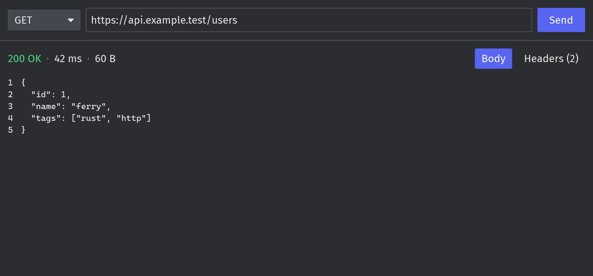

# Ferry

[](https://github.com/KabirRao1/ferry/actions/workflows/ci.yml)
[](LICENSE)

**A native, low-memory, offline HTTP API client.** A lean alternative to Postman, written in Rust.



- **Native UI.** No Electron; a web view is only created for HTML previews. Idles at about 24 MB of RAM and opens in under 100 ms.
- **Handles huge responses.** A 50 MB body scrolls smoothly; only the visible lines are ever rendered.
- **Offline and private.** No account, no sign-in, no telemetry.
- **Plain-file collections.** Requests, environments and globals are TOML files in a folder, so you can keep them in git and review them like code. Secrets stay in git-ignored `*.local.toml` files.

> **Status: early development.** Ferry has collections, environments and variables, history, a cookie jar, a console, response search and previews, in tabs that survive restarts.
> Scripts, the Collection Runner, imports and more protocols are on the [roadmap](#roadmap).

## Quick start

### 1. Install Rust

Install [rustup](https://rustup.rs). Ferry pins its Rust version in `rust-toolchain.toml`, and rustup downloads it automatically the first time you build.

### 2. Install platform build tools

| OS | What you need |
|---|---|
| **Windows** | [Visual Studio Build Tools](https://visualstudio.microsoft.com/visual-cpp-build-tools/) with the **Desktop development with C++** workload. rustup's installer offers to install this for you. |
| **macOS** | Xcode command line tools: `xcode-select --install` |
| **Linux (Debian/Ubuntu)** | `sudo apt install build-essential pkg-config libxkbcommon-dev libwayland-dev` |
| **Linux (Fedora)** | `sudo dnf install gcc pkg-config libxkbcommon-devel wayland-devel` |

### 3. Build and run

```sh
git clone https://github.com/KabirRao1/ferry.git
cd ferry
cargo run --release
```

The first build takes a few minutes. Later builds are incremental.

To install the `ferry` command on your `PATH` instead:

```sh
cargo install --git https://github.com/KabirRao1/ferry ferry-ui
```

## Using Ferry

The window is laid out like Postman: a sidebar on the left, request tabs across the top, the request builder above the response.

1. Pick a method (GET, POST, …) or type your own, such as `PROPFIND`.
2. Type a URL, for example `https://httpbin.org/json`. Query parameters show up in the **Params** table, and editing the table updates the URL.
3. Add what the request needs:
   - **Authorization**: Basic Auth, Bearer Token or API Key.
   - **Headers**: your own rows, plus the headers Ferry adds (click "hidden" to see them).
   - **Body**: form-data (text and files), x-www-form-urlencoded, raw (Text, JSON with validation and Beautify, XML, HTML, JavaScript) or a binary file.
   - **Settings**: turn off following redirects or certificate verification.
4. Press **Send**, **Enter** in the URL field, or **Ctrl+Enter** (**⌘+Enter** on macOS).
5. Read the status, time (hover for the DNS / connect / waiting / download breakdown) and size. JSON is pretty-printed; switch to **Raw** or **Hex** at any time.

Tables have **Bulk Edit** for pasting `key: value` lines. Open tabs, including unsent requests, are restored when you start Ferry again.

### Collections, environments and variables

Ferry keeps your work in a **workspace folder** (by default `workspace` in Ferry's data directory; click the workspace name at the top left to pick another folder). Press **Ctrl+S** to save a request into a collection. Collections, folders and requests appear in the sidebar, where you can rename, duplicate, delete and drag them; every change is a plain file you can commit.

Write `{{name}}` anywhere in a request to use a variable. Values come from the environment picked in the top right, then the collection, then **Globals**. Mark a variable **Secret** to keep its value in a `*.local.toml` file next to the environment, which the workspace's `.gitignore` excludes. Dynamic variables such as `{{$guid}}`, `{{$timestamp}}` and `{{$randomInt}}` get a fresh value on every send.

### After you send

- **History** in the sidebar lists the last 100 requests with their responses; click one to open it again.
- **Cookies** set by responses are kept and sent with later requests to the same site. The response's **Cookies** tab lists what it set; **Cookies** in the footer manages the jar. Turn the jar off for one request in its **Settings**.
- **Console** in the footer logs every request exactly as sent, with its headers and body.
- **Search** (Ctrl+F) finds text in the response body; **Enter** and **Shift+Enter** step through matches.
- For JSON, type a **JSONPath** expression such as `$.items[*].name` above the body to see just those values.
- **Preview** shows HTML, images, audio, video and PDFs (Windows and macOS); **Open in Browser** opens the body with your default application.
- **Save as Example** keeps a response with its saved request.

### Scripts and tests

Each request, folder and collection has a **Scripts** tab with a **Pre-request** script, which runs before the request is sent, and a **Post-response** script, which runs after the response arrives. Scripts are JavaScript with Postman's `pm` API:

```js
// Pre-request: log in and keep the token for this environment.
pm.sendRequest({ url: pm.variables.get("base") + "/login", method: "POST" }, (err, res) => {
  pm.environment.set("token", res.json().token);
});

// Post-response: tests show up in the response's Test Results tab.
pm.test("status is 200", () => pm.response.to.have.status(200));
pm.test("has an id", () => pm.expect(pm.response.json().id).to.be.a("number"));
```

Scripts run in a sandbox with no file, process or network access (apart from `pm.sendRequest`), stop after 5 seconds or 64 MB, and log `console.log` output to the Console. Values scripts store with `pm.environment.set`, `pm.globals.set` or `pm.collectionVariables.set` go to the git-ignored `*.local.toml` files, so running scripts never changes the files you share.

`pm.visualizer.set(template, data)` adds a **Visualize** view to the response: a [Handlebars](https://handlebarsjs.com/) template rendered with your data. Its own scripts can run, for example to draw a chart, but it cannot load or send anything over the network.

### Collection Runner and CLI

**Run** on a collection or folder (its `…` menu, its settings, or **Runner** in the footer) opens the Collection Runner: pick the requests, the number of iterations, a delay and an optional CSV or JSON data file (one iteration per row, its columns available as variables and `pm.iterationData`), then **Run**. Results appear as they finish; **Export Results** saves a JSON report. `pm.execution.setNextRequest("Name")` jumps to another request.

The same runs work headless, for CI, with `ferry-cli`, which release archives include:

```sh
ferry-cli run collections/api --workspace path/to/workspace --environment staging --data users.csv --report report.json
```

It prints each request and its failed tests, and exits with 0 when everything passed, 1 when a request or test failed, and 2 for invalid arguments.

| Shortcut | Action |
|---|---|
| Ctrl+Enter | Send |
| Ctrl+T / Ctrl+W | New tab / close tab |
| Ctrl+Tab / Ctrl+Shift+Tab | Next / previous tab |
| Ctrl+B | Show or hide the sidebar |
| Ctrl+S | Save the request |
| Ctrl+F | Search the response body |

On macOS, use ⌘ instead of Ctrl (Ctrl+Tab stays Ctrl).

## Roadmap

Ferry is heading for Postman's layout and every Postman feature that runs on your machine: no account, no cloud ([parity map](docs/POSTMAN_PARITY.md)).

| Phase | Features | Status |
|---|---|---|
| 0 | Foundations: CI, test harness, performance budgets | ✅ done |
| 1 | Send a request, see status, headers and body | ✅ done |
| 2 | Postman-style workbench, query params, headers, bodies, auth, tabs, redirect/TLS options, timing breakdown | ✅ done |
| 3 | Variables and environments, collections, history, cookies, console, saved examples, HTML preview | ✅ done |
| 4 | Pre-request and test scripts (`pm` API), Collection Runner, CLI, Visualize | ✅ done |
| 5 | Import/export (Postman, cURL, OpenAPI, HAR), code snippets, OAuth and other auth, proxy and certificates, vault | next |
| 6 | GraphQL, WebSocket, Socket.IO, server-sent events, gRPC, MQTT | planned |
| 7 | Local mock server, docs generation, find and replace, settings, keyboard, releases | planned |

## Contributing

Contributions are welcome. See [`CONTRIBUTING.md`](CONTRIBUTING.md) for the development setup, the test-first workflow and the merge gate.

| Document | Contents |
|---|---|
| [`docs/ARCHITECTURE.md`](docs/ARCHITECTURE.md) | How the crates fit together |
| [`docs/SPEC.md`](docs/SPEC.md) | Features and acceptance criteria |
| [`docs/DECISIONS.md`](docs/DECISIONS.md) | Architecture decision records |
| [`docs/FEATURES.md`](docs/FEATURES.md) | Feature status and test counts |
| [`docs/FINDINGS.md`](docs/FINDINGS.md) | QA findings and their regression tests |
| [`CHANGELOG.md`](CHANGELOG.md) | Notable changes per release |

## Security

Please report vulnerabilities privately. See [`SECURITY.md`](SECURITY.md).

## License

Licensed under the Apache License, Version 2.0 ([`LICENSE`](LICENSE)).

Unless you explicitly state otherwise, any contribution you intentionally submit for inclusion in this project, as defined in the Apache-2.0 license, is licensed as above, without any additional terms or conditions.
