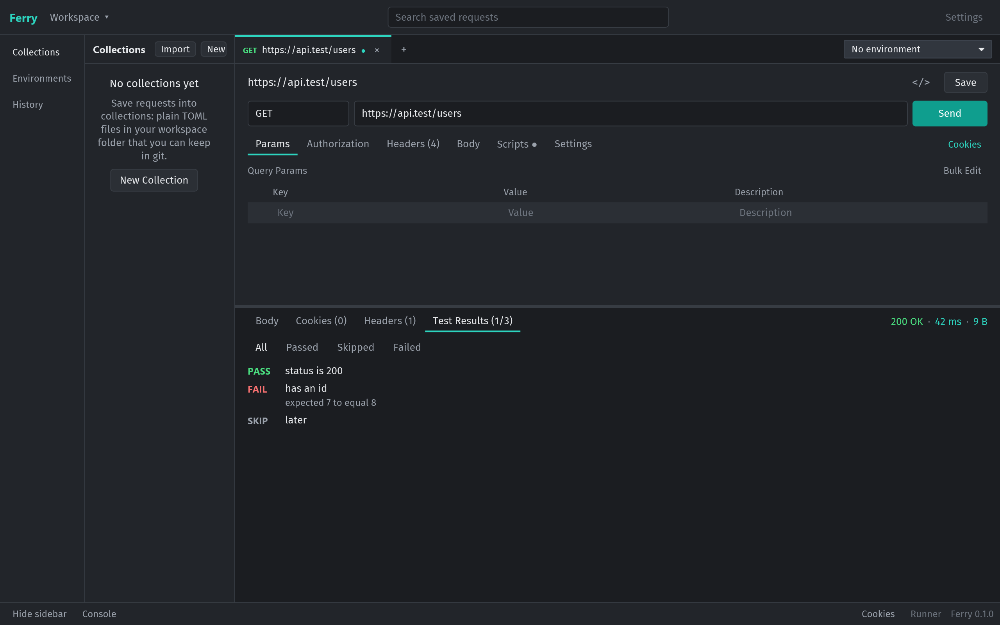
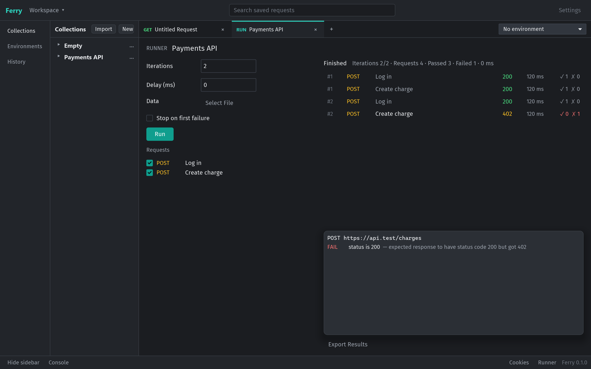
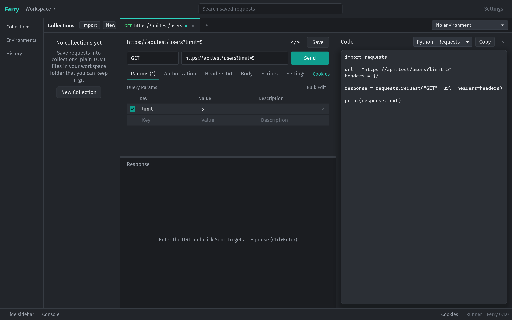
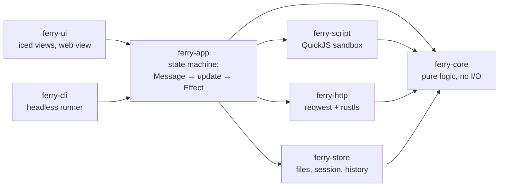

# Ferry

[](https://github.com/KabirRao1/ferry/actions/workflows/ci.yml)
[](LICENSE)


**A fast, native desktop app for testing web APIs: an offline alternative to Postman, written in Rust.**

Developers use tools like Postman to send HTTP requests to an API and inspect what comes back. Postman runs on Electron (a bundled web browser) and pushes you toward a cloud account. Ferry has the same layout and the same local features, but it is a native app that idles at about 24 MB of RAM, opens in under 100 ms, needs no account and keeps everything in plain files you can commit to git.


## At a glance

| | |
|---|---|
| **What** | A cross-platform desktop API client: build requests, send them, inspect responses, script tests, run whole collections |
| **Built with** | Rust, [iced](https://iced.rs) (native UI), reqwest + rustls (HTTP), QuickJS (sandboxed JavaScript), wry (embedded web view) |
| **Size** | About 39,000 lines of Rust in 8 crates, 663 automated tests, 53 written design decisions |
| **Quality gates** | Coverage floors, mutation testing, fuzzing, UI snapshot tests and performance budgets, run on Windows, macOS and Linux in CI |
| **Status** | Phases 0–4 complete; Phase 5 (import/export, code snippets, advanced auth) in progress |

## What it does

**Build and send requests.** Any method, query parameters kept in sync with the URL, headers, JSON / form / file bodies, Basic, Bearer and API-key auth. The response shows status, size and a timing breakdown (DNS, connect, waiting, download), with pretty-printed JSON, search, JSONPath filtering and HTML / image / PDF previews. Bodies of hundreds of megabytes scroll smoothly.

**Write tests in JavaScript.** Each request can run scripts before and after it is sent, using Postman's `pm` API, so existing Postman tests work as they are.



**Run whole collections.** The Collection Runner sends a folder of requests in order, repeats them over rows of a CSV or JSON data file, and reports every test. `ferry-cli` runs the same collections headless in CI and exits non-zero when a test fails.



**Generate code, import from Postman.** The Code panel shows the current request in 12 languages (cURL, Python, JavaScript, Go, Rust, Java and more). Postman collections and environments import and export, and pasting a `curl` command into the URL bar turns it into a request.



**Organize your work.** Collections and folders are TOML files in a workspace folder you can version in git. Environments and `{{variables}}` switch between dev and production, and secrets stay in git-ignored files. History, a cookie jar, a console and tabs that survive restarts are all built in.

The [user guide](docs/USER_GUIDE.md) walks through every feature.

## How it is built



The dependency direction above is enforced by a build check (`cargo xtask arch`), so the UI can never reach around the app layer to the network or the disk.

### Engineering highlights

- **Elm architecture, tested without a screen.** The whole app is a state machine: user actions are `Message`s, `update()` changes state and returns `Effect`s (send, save, copy) for a thin shell to perform. `update()` does no I/O and gets time and randomness injected, so every user flow, from typing a URL to running a collection, is tested headless and deterministically.
- **Huge responses in little memory.** A line index over the raw bytes and a virtualized view mean only the visible lines are ever laid out. Search and filtering run on background threads and drop stale results by job id.
- **A real JavaScript sandbox.** Each script gets a fresh QuickJS runtime with 64 MB memory, 5 second and stack limits, and no file, process or network access. Postman's `pm` API is a JavaScript layer over a small native bridge. Time spent waiting on `pm.sendRequest` doesn't count against the limit.
- **Secure previews.** HTML previews run in the OS web view with scripts off and navigation, downloads and new windows blocked. The Visualize view allows scripts, but behind a Content Security Policy that blocks all network access.
- **Git-friendly storage.** One file per request, atomic writes, live reload when files change on disk, and secrets kept out of shared files.
- **Code generators checked against a parser.** Snippets for 12 languages are pinned with snapshot tests, and a property test generates random requests, turns each into cURL and parses it back to check that nothing is lost.

### How it is tested

| Technique | What it does here |
|---|---|
| Unit and integration tests | 663 tests, each named after the acceptance criterion it covers (e.g. `f15_ac9_…`) in the [spec](docs/SPEC.md) |
| Headless UI tests | iced's simulator clicks and types into the real views; 22 byte-exact screenshot tests catch visual regressions |
| End-to-end | Real HTTP against local mock servers (wiremock), including the CLI binary |
| Property-based tests | proptest for URL/params sync, variables, cookies, cURL round-trips |
| Fuzzing | 7 cargo-fuzz targets; findings such as unbounded JSON nesting and variable-expansion blow-ups are fixed with regression tests |
| Mutation testing | cargo-mutants on every change and nightly over the whole codebase in 8 parallel shards; any surviving mutant needs a new test |
| Coverage floors | core, app and store must stay at 90 % or more (currently 92–99 %) |
| Performance budgets | Idle memory, startup time, frame time while scrolling a 50 MB body, and binary size, measured on all three OSes |
| Supply chain | cargo-deny checks licenses, security advisories and crate sources |

Every bug these checks found is written up with its fix and regression test in [FINDINGS.md](docs/FINDINGS.md), and every design choice is recorded with its alternatives in [DECISIONS.md](docs/DECISIONS.md).

## Run it

Install [Rust](https://rustup.rs) and your platform's build tools:

| OS | What you need |
|---|---|
| **Windows** | [Visual Studio Build Tools](https://visualstudio.microsoft.com/visual-cpp-build-tools/) with **Desktop development with C++** (rustup's installer offers it) |
| **macOS** | `xcode-select --install` |
| **Linux (Debian/Ubuntu)** | `sudo apt install build-essential pkg-config libxkbcommon-dev libwayland-dev` |
| **Linux (Fedora)** | `sudo dnf install gcc pkg-config libxkbcommon-devel wayland-devel` |

Then:

```sh
git clone https://github.com/KabirRao1/ferry.git
cd ferry
cargo run --release
```

The first build takes a few minutes. Try `https://httpbin.org/json` in the URL bar and press **Ctrl+Enter**. To run the tests: `cargo test --workspace`; to run the full merge gate: `cargo xtask gate`.

## Roadmap

The goal is every Postman feature that runs on your own machine ([parity map](docs/POSTMAN_PARITY.md)).

| Phase | Features | Status |
|---|---|---|
| 0 | Foundations: CI, test harness, performance budgets | ✅ done |
| 1 | Send a request, see status, headers and body | ✅ done |
| 2 | Postman-style workbench: params, headers, bodies, auth, tabs, timing | ✅ done |
| 3 | Environments and variables, collections, history, cookies, console, previews | ✅ done |
| 4 | JavaScript scripts and tests, Collection Runner, CLI, Visualize | ✅ done |
| 5 | Code snippets ✅, cURL and Postman import/export ✅, OpenAPI / HAR import, OAuth 2.0 and other auth, proxy, vault | in progress |
| 6 | GraphQL, WebSocket, Socket.IO, server-sent events, gRPC, MQTT | planned |
| 7 | Local mock server, docs generation, settings, releases | planned |

## Documentation

| Document | Contents |
|---|---|
| [`docs/USER_GUIDE.md`](docs/USER_GUIDE.md) | How to use every feature |
| [`docs/OVERVIEW.md`](docs/OVERVIEW.md) | One-page summary of features, architecture and verification |
| [`docs/ARCHITECTURE.md`](docs/ARCHITECTURE.md) | How the crates fit together |
| [`docs/SPEC.md`](docs/SPEC.md) | Features and acceptance criteria |
| [`docs/DECISIONS.md`](docs/DECISIONS.md) | Architecture decision records |
| [`docs/FEATURES.md`](docs/FEATURES.md) | Feature status and test counts |
| [`docs/FINDINGS.md`](docs/FINDINGS.md) | Bugs found by testing, with their regression tests |
| [`CONTRIBUTING.md`](CONTRIBUTING.md) | Development setup and the merge gate |

## License

Apache License 2.0 ([`LICENSE`](LICENSE)). To report a vulnerability, see [`SECURITY.md`](SECURITY.md).
